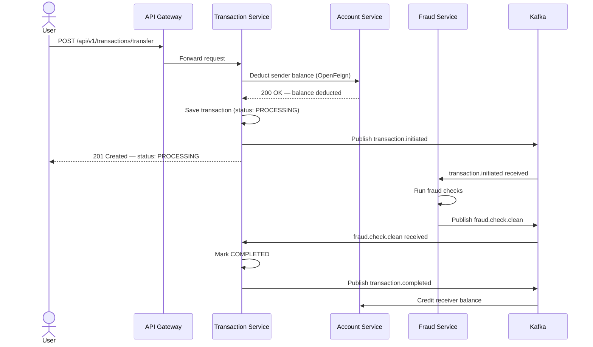
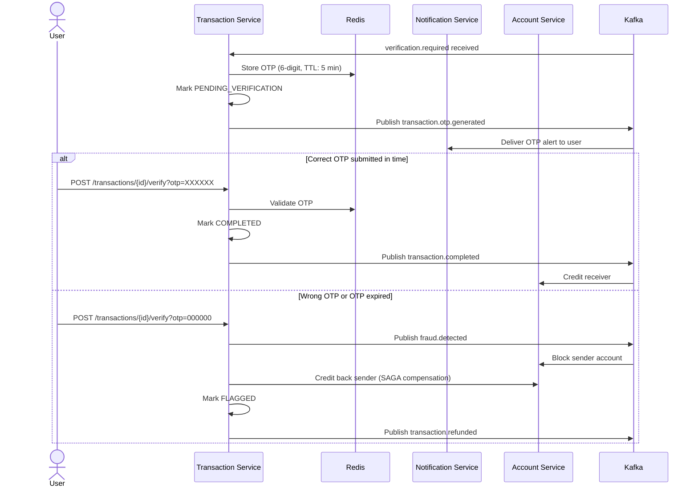
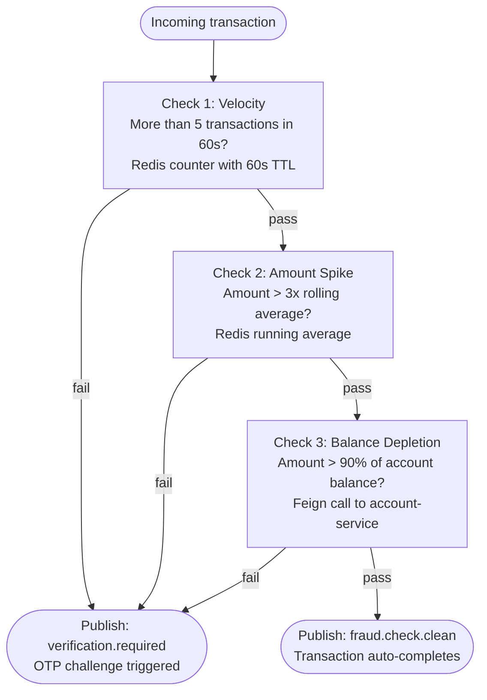

# Digital Banking System — Microservices

[](https://openjdk.org/)
[](https://spring.io/projects/spring-boot)
[](https://spring.io/projects/spring-cloud)
[](https://kafka.apache.org/)
[](https://redis.io/)
[](https://www.mysql.com/)
[](https://www.docker.com/)

A backend implementation of a core banking platform built on microservices. The system handles money transfers across distributed services without a shared database, using the **SAGA choreography pattern** to keep data consistent. It includes a real-time fraud detection engine, Redis-based rate limiting at the gateway, and a Razorpay payment integration.

---

## Table of Contents

- [System Overview](#system-overview)
- [Services](#services)
- [How a Transfer Works (SAGA)](#how-a-transfer-works-saga)
- [Fraud Detection](#fraud-detection)
- [Rate Limiting](#rate-limiting)
- [Razorpay Integration](#razorpay-integration)
- [Kafka Topics](#kafka-topics)
- [Database Schema](#database-schema)
- [API Reference](#api-reference)
- [Tech Stack](#tech-stack)
- [Project Structure](#project-structure)
- [Local Setup](#local-setup)
- [Testing the Flows](#testing-the-flows)
- [Roadmap](#roadmap)

---

## System Overview

```
                        +-------------+
                        |   Client    |
                        +------+------+
                               | HTTP
                        +------v------+
                        | API Gateway |  <- Rate limiting (Redis)
                        |  Port 8080  |
                        +--+---+---+--+
                           |   |   |
           +---------------+   |   +---------------+
           |                   |                   |
    +------v-----+   +---------v----+   +----------v---+
    |  Account   |   | Transaction  |   |   Payment    |
    |  Service   |   |   Service    |   |   Service    |
    |  Port 8081 |   |  Port 8082   |   |  Port 8083   |
    +------+-----+   +------+-------+   +------+-------+
           |                |                   |
      account_db       transaction_db       payment_db
           |                |                   |
           +----------------+-------------------+
                            |
                     +------v------+
                     |    Kafka    |  <- Event bus
                     +------+------+
                    +-------+--------+
             +------v-----+   +------v------+
             |   Fraud    |   |Notification |
             | Detection  |   |   Service   |
             |  Port 8084 |   |  Port 8085  |
             +------------+   +-------------+
```

**Key design decisions:**

- **No shared database** — each service owns its data; services talk to each other via Kafka events or Feign HTTP calls.
- **Async by default** — the transfer API responds immediately with `PROCESSING`, the rest happens in the background via Kafka.
- **Redis** is used for three things: gateway rate limiting, OTP storage (with TTL), and fraud velocity counters.

---

## Services

| Service | Port | Storage | What it does |
| :--- | :---: | :---: | :--- |
| `api-gateway` | `8080` | Redis | Routes requests, enforces IP-based rate limits |
| `account-service` | `8081` | MySQL | Creates accounts, manages balances, handles blocking |
| `transaction-service` | `8082` | MySQL + Redis | Coordinates fund transfers via SAGA, handles OTP |
| `fraud-detection-service` | `8084` | Redis + Feign | Runs fraud checks on every transaction |
| `payment-service` | `8083` | MySQL | Creates Razorpay orders, processes webhooks |
| `notification-service` | `8085` | — | Consumes Kafka events and sends alerts |

---

## How a Transfer Works (SAGA)

The core problem: transferring money involves two accounts in separate databases. If we debit one and the credit fails, we need a way to undo the debit. This is what the SAGA pattern solves.

### The Happy Path



1. Sender's balance is **debited synchronously** via Feign before anything else.
2. A `transaction.initiated` event is published. The API returns `201 PROCESSING` to the client immediately.
3. The fraud service picks it up, runs checks, and publishes `fraud.check.clean`.
4. Transaction service marks it `COMPLETED` and publishes `transaction.completed`.
5. Account service credits the receiver.

---

### When Fraud is Suspected → OTP Challenge

If fraud checks flag a transaction, the flow branches:



The **SAGA compensation** is the refund step — if the OTP check fails, we restore the sender's balance by crediting it back synchronously.

---

### Transaction States

```
PROCESSING  ──(fraud clean)──────────────────────► COMPLETED
PROCESSING  ──(fraud flagged)────────────────────► PENDING_VERIFICATION
PENDING_VERIFICATION  ──(correct OTP)────────────► COMPLETED
PENDING_VERIFICATION  ──(wrong OTP / expired)────► FLAGGED  (+refund to sender)
```

---

## Fraud Detection

Every transaction goes through three checks inside `fraud-detection-service`:



**Why three checks?**
- **Velocity** — catches scripted/bot-driven rapid drain attacks.
- **Amount spike** — flags transfers that are unusually large compared to the account's historical behaviour.
- **Balance depletion** — catches one-shot wipeouts even if the raw amount looks normal.

---

## Rate Limiting

Configured at the API Gateway using Spring Cloud Gateway + Redis Token Bucket:

| Route | Replenish Rate | Burst Capacity |
| :--- | :---: | :---: |
| `/api/v1/accounts/**` | 10 req/s | 20 |
| `/api/v1/transactions/**` | 10 req/s | 20 |
| `/api/v1/payments/**` | 5 req/s | 10 |

Rate limiting is per IP address. Exceeding limits returns `HTTP 429`.

---

## Razorpay Integration

The `payment-service` handles external payment deposits:

1. Client calls `POST /api/v1/payments/create-order` with an amount.
2. Service creates a Razorpay order (converts INR → paise: `amount × 100`).
3. Client uses the returned `razorpayOrderId` to complete payment on the frontend.
4. Razorpay sends a webhook (`payment.captured` or `payment.failed`) to `POST /api/v1/payments/webhook`.
5. Service updates the payment record and publishes a Kafka event for notifications.

---

## Kafka Topics

| Topic | Published by | Consumed by | When |
| :--- | :--- | :--- | :--- |
| `transaction.initiated` | transaction-service | fraud-detection-service | Transfer request received |
| `fraud.check.clean` | fraud-detection-service | transaction-service | All fraud checks pass |
| `verification.required` | fraud-detection-service | transaction-service | A fraud check triggers |
| `transaction.otp.generated` | transaction-service | notification-service | OTP has been generated |
| `transaction.completed` | transaction-service | account-service, notification-service | Transfer completed |
| `fraud.detected` | transaction-service | account-service, notification-service | Wrong OTP submitted |
| `transaction.refunded` | transaction-service | notification-service | SAGA compensation executed |
| `payment.completed` | payment-service | notification-service | Razorpay payment captured |
| `payment.failed` | payment-service | notification-service | Razorpay payment failed |

---

## Database Schema

Each service has its own isolated database, created automatically from `init.sql` on Docker startup.

### `account_db` — `accounts`

| Column | Type | Notes |
| :--- | :--- | :--- |
| `id` | VARCHAR(36) | UUID, primary key |
| `account_number` | VARCHAR(12) | Unique, cryptographically generated |
| `account_holder_name` | VARCHAR(255) | |
| `email` | VARCHAR(255) | Unique |
| `phone` | VARCHAR(20) | |
| `account_type` | ENUM | `SAVINGS`, `CURRENT` |
| `status` | ENUM | `ACTIVE`, `BLOCKED`, `SUSPENDED`, `CLOSED` |
| `balance` | DECIMAL(15,2) | |
| `daily_transaction_limit` | DECIMAL(15,2) | ₹1,00,000 (SAVINGS), ₹5,00,000 (CURRENT) |
| `created_at`, `updated_at` | TIMESTAMP | |

### `transaction_db` — `transactions`

| Column | Type | Notes |
| :--- | :--- | :--- |
| `id` | VARCHAR(36) | UUID, primary key |
| `sender_account_number` | VARCHAR(255) | |
| `receiver_account_number` | VARCHAR(255) | |
| `amount` | DECIMAL(15,2) | |
| `type` | ENUM | `TRANSFER`, `DEPOSIT`, `WITHDRAWAL`, `PAYMENT` |
| `status` | ENUM | `PENDING`, `PROCESSING`, `PENDING_VERIFICATION`, `COMPLETED`, `FAILED`, `FLAGGED` |
| `reference_number` | VARCHAR(36) | UUID |
| `failure_reason` | VARCHAR(255) | Populated on `FLAGGED`/`FAILED` |
| `created_at`, `completed_at` | TIMESTAMP | |

### `payment_db` — `payments`

| Column | Type | Notes |
| :--- | :--- | :--- |
| `id` | VARCHAR(36) | UUID, primary key |
| `razorpay_order_id` | VARCHAR(255) | From Razorpay API |
| `razorpay_payment_id` | VARCHAR(255) | Set after webhook |
| `account_number` | VARCHAR(255) | |
| `amount` | DECIMAL(15,2) | |
| `currency` | VARCHAR(10) | `INR` |
| `status` | ENUM | `CREATED`, `PENDING`, `COMPLETED`, `FAILED`, `REFUNDED` |
| `failure_reason` | VARCHAR(255) | |
| `created_at`, `updated_at` | TIMESTAMP | |

---

## API Reference

All endpoints are available through the API Gateway on port `8080`, or directly on each service's port.

### Account Service — `/api/v1/accounts`

<details>
<summary><strong>POST</strong> /api/v1/accounts — Create account</summary>

**Request:**
```json
{
  "accountHolderName": "John Doe",
  "email": "john.doe@example.com",
  "phone": "+919876543210",
  "accountType": "SAVINGS",
  "initialDeposit": 25000.00
}
```

**Response `201 Created`:**
```json
{
  "id": "e7b0c3fa-774f-4ab3-9c88-123456789abc",
  "accountNumber": "049182736451",
  "accountHolderName": "John Doe",
  "email": "john.doe@example.com",
  "accountType": "SAVINGS",
  "status": "ACTIVE",
  "balance": 25000.00,
  "dailyTransactionLimit": 100000.00,
  "createdAt": "2026-09-18T10:30:00"
}
```
</details>

<details>
<summary><strong>GET</strong> /api/v1/accounts/{accountNumber} — Get account details</summary>

**Response `200 OK`:**
```json
{
  "accountNumber": "049182736451",
  "accountHolderName": "John Doe",
  "email": "john.doe@example.com",
  "status": "ACTIVE",
  "balance": 25000.00
}
```
</details>

<details>
<summary><strong>GET</strong> /api/v1/accounts/{accountNumber}/balance — Get balance</summary>

**Response `200 OK`:** `25000.00`
</details>

<details>
<summary><strong>PUT</strong> /api/v1/accounts/{accountNumber}/block — Block account</summary>

**Response `200 OK`:** `Account blocked successfully`
</details>

---

### Transaction Service — `/api/v1/transactions`

<details>
<summary><strong>POST</strong> /api/v1/transactions/transfer — Initiate transfer</summary>

**Request:**
```json
{
  "senderAccountNumber": "049182736451",
  "receiverAccountNumber": "098765432109",
  "amount": 5000.00,
  "description": "Consulting Fee"
}
```

**Response `201 Created`:**
```json
{
  "id": "c85d89b1-b924-4f22-a58f-28782a173bd9",
  "senderAccountNumber": "049182736451",
  "receiverAccountNumber": "098765432109",
  "amount": 5000.00,
  "type": "TRANSFER",
  "status": "PROCESSING",
  "description": "Consulting Fee",
  "referenceNumber": "8c42a450-4822-4876-9da8-a006bb0b9e84",
  "createdAt": "2026-09-18T10:35:00",
  "completedAt": null
}
```

> Status starts as `PROCESSING`. Poll `GET /transactions/{id}` to check final status.
</details>

<details>
<summary><strong>POST</strong> /api/v1/transactions/{id}/verify?otp={otp} — Submit OTP</summary>

**Correct OTP — Response `200 OK`:**
```json
{
  "id": "c85d89b1-b924-4f22-a58f-28782a173bd9",
  "status": "COMPLETED",
  "completedAt": "2026-09-18T10:36:12"
}
```

**Wrong OTP — Response `200 OK`:**
```json
{
  "id": "c85d89b1-b924-4f22-a58f-28782a173bd9",
  "status": "FLAGGED",
  "failureReason": "Wrong OTP entered - transaction cancelled, account blocked for security - SAGA Compensation executed, amount refunded"
}
```
</details>

<details>
<summary><strong>GET</strong> /api/v1/transactions/{id} — Get transaction by ID</summary>

Returns the standard transaction object.
</details>

<details>
<summary><strong>GET</strong> /api/v1/transactions/account/{accountNumber} — Transaction history</summary>

**Response `200 OK`:**
```json
[
  {
    "id": "c85d89b1-b924-4f22-a58f-28782a173bd9",
    "senderAccountNumber": "049182736451",
    "receiverAccountNumber": "098765432109",
    "amount": 5000.00,
    "status": "COMPLETED",
    "createdAt": "2026-09-18T10:35:00"
  }
]
```
</details>

---

### Payment Service — `/api/v1/payments`

<details>
<summary><strong>POST</strong> /api/v1/payments/create-order — Create Razorpay order</summary>

**Request:**
```json
{
  "accountNumber": "049182736451",
  "amount": 1500.00,
  "description": "Wallet Load via Razorpay"
}
```

**Response `201 Created`:**
```json
{
  "paymentId": "f9a1e8d4-55cc-44ee-b7d1-332211aabbcc",
  "razorpayOrderId": "order_OG72hKabc123",
  "amount": 1500.00,
  "currency": "INR",
  "keyId": "rzp_test_your_key_id",
  "status": "CREATED"
}
```
</details>

<details>
<summary><strong>POST</strong> /api/v1/payments/webhook — Razorpay webhook receiver</summary>

Accepts standard Razorpay webhook JSON (`payment.captured` or `payment.failed`).

**Response `200 OK`:** `Webhook processed`
</details>

---

## Tech Stack

| Layer | Technology |
| :--- | :--- |
| Language | Java 25 (compatible with Java 21 LTS) |
| Framework | Spring Boot 4.1.1, Spring Cloud 2025.1.2 |
| API Gateway | Spring Cloud Gateway (WebFlux / Netty) |
| Service Communication | Spring Cloud OpenFeign (sync), Apache Kafka (async) |
| Message Broker | Apache Kafka 7.4.0 (Confluent) + Zookeeper |
| Database | MySQL 8.0, Spring Data JPA / Hibernate 6 |
| Cache / State | Redis 7 (Lettuce driver) |
| Payments | Razorpay Java SDK 1.4.6 |
| DevOps | Docker, Docker Compose v3.8, Maven Wrapper |
| Observability | Spring Boot Actuator |

---

## Project Structure

```
bankingSystemManthan/
├── .env.example
├── docker-compose.yml
├── init.sql                              # Creates account_db, transaction_db, payment_db
│
├── api-gateway/
│   └── src/.../config/RateLimiterConfig.java
│
├── account-service/
│   └── src/.../
│       ├── controller/AccountController.java
│       ├── model/Account.java
│       └── service/AccountService.java
│
├── transaction-service/
│   └── src/.../
│       ├── client/AccountServiceClient.java      # Feign client
│       ├── controller/TransactionController.java
│       ├── service/TransactionService.java
│       └── service/TransactionEventConsumer.java
│
├── fraud-detection-service/
│   └── src/.../
│       ├── client/AccountServiceClient.java      # Feign client
│       └── service/FraudDetectionService.java
│
├── payment-service/
│   └── src/.../
│       ├── controller/PaymentController.java
│       └── service/PaymentService.java
│
└── notification-service/
    └── src/.../service/NotificationService.java
```

---

## Local Setup

### Prerequisites

- **Java 21 or 25** — `java -version`
- **Maven 3.9+** — `mvn -version`
- **Docker + Docker Compose** — `docker --version`

---

### 1. Clone the repo

```bash
git clone https://github.com/Manthan-Sagar/Digital-Banking-System-Microservices.git
cd Digital-Banking-System-Microservices
```

### 2. Set up environment variables

```bash
cp .env.example .env
```

Edit `.env` with your credentials:

```properties
MYSQL_HOST_PORT=3388
REDIS_HOST_PORT=6379
KAFKA_HOST_PORT=29092

RAZORPAY_KEY_ID=rzp_test_your_key_id
RAZORPAY_KEY_SECRET=your_razorpay_secret
RAZORPAY_WEBHOOK_SECRET=your_webhook_secret
```

### 3. Start infrastructure

```bash
docker compose up -d
docker compose ps   # verify all containers are healthy
```

Expected containers: `banking-mysql` (3388), `banking-redis` (6379), `banking-zookeeper` (2181), `banking-kafka` (29092)

### 4. Start the services

Open a terminal for each service:

```bash
# Terminal 1
cd account-service && ./mvnw spring-boot:run

# Terminal 2
cd transaction-service && ./mvnw spring-boot:run

# Terminal 3
cd fraud-detection-service && ./mvnw spring-boot:run

# Terminal 4
cd payment-service && ./mvnw spring-boot:run

# Terminal 5
cd notification-service && ./mvnw spring-boot:run

# Terminal 6
cd api-gateway && ./mvnw spring-boot:run
```

> **Windows:** replace `./mvnw` with `mvnw.cmd`

---

## Testing the Flows

### 1. Create two accounts

```bash
# Alice (sender)
curl -X POST http://localhost:8080/api/v1/accounts \
  -H "Content-Type: application/json" \
  -d '{
    "accountHolderName": "Alice Johnson",
    "email": "alice@example.com",
    "phone": "+919876543210",
    "accountType": "SAVINGS",
    "initialDeposit": 100000.00
  }'

# Bob (receiver)
curl -X POST http://localhost:8080/api/v1/accounts \
  -H "Content-Type: application/json" \
  -d '{
    "accountHolderName": "Bob Smith",
    "email": "bob@example.com",
    "phone": "+919876543211",
    "accountType": "SAVINGS",
    "initialDeposit": 10000.00
  }'
```

Note down the `accountNumber` from each response.

---

### 2. Normal transfer (fraud checks pass)

```bash
curl -X POST http://localhost:8080/api/v1/transactions/transfer \
  -H "Content-Type: application/json" \
  -d '{
    "senderAccountNumber": "<ALICE_ACCOUNT>",
    "receiverAccountNumber": "<BOB_ACCOUNT>",
    "amount": 2000.00,
    "description": "Dinner Split"
  }'
```

Expected: Alice debited → fraud checks pass → Bob credited → notifications logged.

---

### 3. Suspicious transfer → OTP challenge → success

Send a large amount (triggers the >90% balance check):

```bash
curl -X POST http://localhost:8080/api/v1/transactions/transfer \
  -H "Content-Type: application/json" \
  -d '{
    "senderAccountNumber": "<ALICE_ACCOUNT>",
    "receiverAccountNumber": "<BOB_ACCOUNT>",
    "amount": 95000.00,
    "description": "High Value Transfer"
  }'
```

Check the notification-service logs for the OTP, then verify:

```bash
curl -X POST "http://localhost:8080/api/v1/transactions/<TRANSACTION_ID>/verify?otp=<OTP>"
```

---

### 4. Wrong OTP → SAGA compensation

Submit an incorrect OTP:

```bash
curl -X POST "http://localhost:8080/api/v1/transactions/<TRANSACTION_ID>/verify?otp=000000"
```

Expected: Alice's money is refunded, her account is blocked, notification logged.

---

### 5. Razorpay payment order

```bash
curl -X POST http://localhost:8080/api/v1/payments/create-order \
  -H "Content-Type: application/json" \
  -d '{
    "accountNumber": "<ALICE_ACCOUNT>",
    "amount": 500.00,
    "description": "Deposit via UPI"
  }'
```

Returns a `razorpayOrderId`. Use the Razorpay test dashboard to simulate a webhook.

---

## Roadmap

- [ ] **Distributed tracing** — OpenTelemetry + Grafana Tempo / Zipkin
- [ ] **Authentication** — Spring Security + OAuth2 / Keycloak JWT at the gateway
- [ ] **Dead Letter Queues** — Kafka DLT for failed message processing
- [ ] **Idempotent consumers** — Redis deduplication keys to prevent duplicate credits on retry
- [ ] **Kubernetes** — Helm charts + K8s manifests for production deployment

---

## Author

**Manthan Sagar**
- GitHub: [@Manthan-Sagar](https://github.com/Manthan-Sagar)
