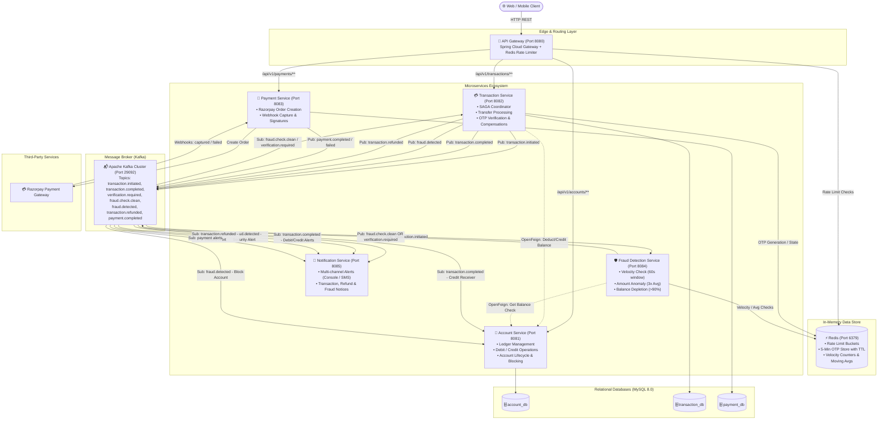
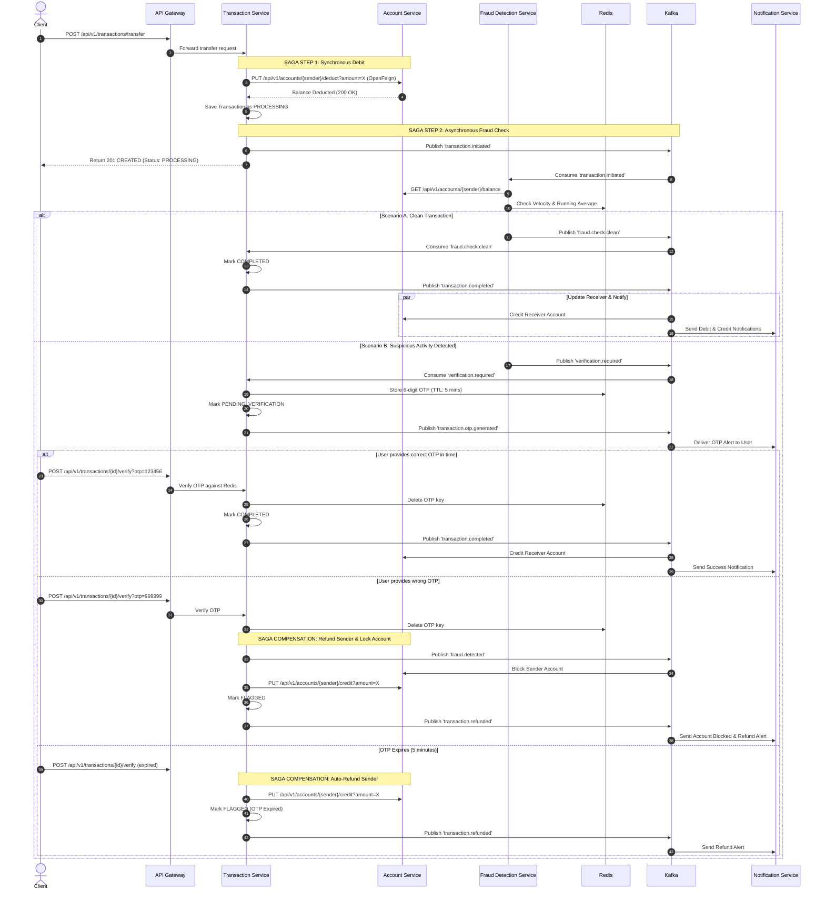

# 🏦 Distributed Digital Banking Platform — Microservices Architecture

[](https://openjdk.org/)
[](https://spring.io/projects/spring-boot)
[](https://spring.io/projects/spring-cloud)
[](https://kafka.apache.org/)
[](https://redis.io/)
[](https://www.mysql.com/)
[](https://www.docker.com/)
[](https://razorpay.com/)

A production-ready, highly scalable, and fault-tolerant **Digital Banking System** engineered with a **Distributed Microservices Architecture**. This platform models real-world core banking operations, featuring **Distributed Transactions with SAGA Choreography and Automatic Compensations**, **Real-Time Multi-Pattern Fraud Detection**, **Distributed Rate Limiting with Redis & Spring Cloud Gateway**, and **Seamless Third-Party Payment Gateway Integration via Razorpay**.

---

## 📑 Table of Contents

- [Architectural Overview](#-architectural-overview)
- [System Architecture Diagram](#-system-architecture-diagram)
- [Microservices Catalog](#-microservices-catalog)
- [Core Engineering Highlights](#-core-engineering-highlights)
  - [1. Distributed SAGA Pattern & Choreography](#1-distributed-saga-pattern--choreography)
  - [2. Multi-Layered Fraud Detection Engine](#2-multi-layered-fraud-detection-engine)
  - [3. Distributed Rate Limiting (Token Bucket)](#3-distributed-rate-limiting-token-bucket)
  - [4. Razorpay Payment Gateway & Webhook Lifecycle](#4-razorpay-payment-gateway--webhook-lifecycle)
- [Kafka Event-Driven Messaging Matrix](#-kafka-event-driven-messaging-matrix)
- [Database Schema & Multi-Database Strategy](#-database-schema--multi-database-strategy)
- [REST API Reference](#-rest-api-reference)
  - [Account Service Endpoints](#account-service-port-8081--gateway-8080)
  - [Transaction Service Endpoints](#transaction-service-port-8082--gateway-8080)
  - [Payment Service Endpoints](#payment-service-port-8083--gateway-8080)
- [Technology Stack](#-technology-stack)
- [Project Directory Structure](#-project-directory-structure)
- [Local Setup & Getting Started](#-local-setup--getting-started)
  - [Prerequisites](#prerequisites)
  - [Step 1: Clone the Repository](#step-1-clone-the-repository)
  - [Step 2: Configure Environment Variables](#step-2-configure-environment-variables)
  - [Step 3: Start Infrastructure Services (Docker Compose)](#step-3-start-infrastructure-services-docker-compose)
  - [Step 4: Build and Start Microservices](#step-4-build-and-start-microservices)
- [End-to-End Verification Scenarios](#-end-to-end-verification-scenarios)
- [Production Considerations & Future Roadmap](#-production-considerations--future-roadmap)

---

## 🏛 Architectural Overview

The banking platform implements a decoupled microservices design adhering to Domain-Driven Design (DDD) principles and high-throughput architectural patterns:

- **Single Entry Perimeter**: All client traffic is routed through a reactive **Spring Cloud API Gateway** that terminates external requests, performs IP-based rate limiting using Redis, and routes traffic to downstream microservices.
- **Database-per-Service**: Each domain service maintains dedicated database schemas (`account_db`, `transaction_db`, `payment_db`) ensuring strict domain isolation, loose coupling, and data ownership boundaries.
- **Event-Driven Choreography**: Services communicate asynchronously over **Apache Kafka**, ensuring non-blocking operations, eventual consistency, and extreme resilience during load spikes.
- **Distributed State & In-Memory Caching**: **Redis** is leveraged for distributed token-bucket rate limiting, short-lived Two-Factor Authentication (OTP) state with TTL expiry, and sliding-window velocity tracking for fraud evaluation.
- **Declarative Inter-Service Communication**: Synchronous inter-service queries and balance operations utilize **Spring Cloud OpenFeign** clients.

---

## 📊 System Architecture Diagram



---

## 📦 Microservices Catalog

| Service Name | Port | Database / State Store | Key Domain Responsibilities |
| :--- | :---: | :---: | :--- |
| **`api-gateway`** | `8080` | Redis (Port `6379`) | Unified reverse proxy, route predicates, dynamic IP-based Token Bucket rate limiting via Redis, Spring Actuator health monitoring. |
| **`account-service`** | `8081` | MySQL (`account_db`) | Account lifecycle, secure 12-digit account number generation (`SecureRandom`), daily transaction limits, balance checks, synchronous debit/credit ledger operations, auto-blocking upon fraud event. |
| **`transaction-service`** | `8082` | MySQL (`transaction_db`), Redis | SAGA orchestration for fund transfers, transaction state machine (`PROCESSING`, `PENDING_VERIFICATION`, `COMPLETED`, `FLAGGED`), OTP generation & Redis caching, automated SAGA compensations/refunds. |
| **`fraud-detection-service`** | `8084` | Redis, OpenFeign (`account-service`) | Real-time multi-pattern fraud analysis engine: transaction velocity tracking, amount anomaly detection (rolling average baseline), balance threshold verification. |
| **`payment-service`** | `8083` | MySQL (`payment_db`) | Razorpay order generation, currency handling (INR in paise), webhook ingestion (`payment.captured`, `payment.failed`), payment status tracking, CORS support. |
| **`notification-service`** | `8085` | In-Memory (Event Consumer) | Asynchronous consumer for notifications across all business domains: debit/credit alerts, 2FA OTP delivery, account lockout notifications, refund receipts, and payment status updates. |

---

## ⚙️ Core Engineering Highlights

### 1. Distributed SAGA Pattern & Choreography

Transferring money across distributed microservices cannot rely on ACID database transactions across multiple databases. This project solves the problem using an **Asynchronous Choreographed SAGA with Compensating Transactions**:



---

### 2. Multi-Layered Fraud Detection Engine

Every transaction is evaluated in real time through three independent, configurable risk heuristics in `fraud-detection-service`:

```
                                  Incoming Transaction
                                           │
                                           ▼
                 ┌──────────────────────────────────────────────────┐
                 │  Pattern 1: Velocity Check (Redis)               │
                 │  Key: fraud:velocity:{accountNumber}             │
                 │  Threshold: > 5 transactions within 60 seconds   │
                 └─────────────────────────┬────────────────────────┘
                                           │ Passed
                                           ▼
                 ┌──────────────────────────────────────────────────┐
                 │  Pattern 2: Amount Spike Anomaly (Redis)         │
                 │  Key: fraud:avg_amount:{accountNumber}           │
                 │  Threshold: Amount > 3.0x Rolling Average        │
                 └─────────────────────────┬────────────────────────┘
                                           │ Passed
                                           ▼
                 ┌──────────────────────────────────────────────────┐
                 │  Pattern 3: Balance Depletion Check (OpenFeign)  │
                 │  Source: Real-time balance from Account Service  │
                 │  Threshold: Amount > 90% of available balance    │
                 └─────────────────────────┬────────────────────────┘
                                           │
                        ┌──────────────────┴──────────────────┐
                        │                                     │
                 [ All Passed ]                        [ Any Triggered ]
                        │                                     │
                        ▼                                     ▼
             Emit: fraud.check.clean             Emit: verification.required
             (Immediate Completion)              (Challenges with 5-min OTP)
```

1. **Velocity Check**: Uses Redis atomic `increment()` with a 60-second sliding expiration. Prevents automated rapid-drain attacks.
2. **Amount Anomaly**: Maintains an adaptive rolling average of historical transfers. If the incoming transfer exceeds $3.0\times$ the historical average, it is flagged.
3. **Balance Depletion**: Queries `account-service` dynamically using OpenFeign to ensure high-value single transfers that wipe out $> 90\%$ of an account's reserves require explicit step-up authentication.

---

### 3. Distributed Rate Limiting (Token Bucket)

Configured at the **API Gateway** layer using **Spring Cloud Gateway** and **Redis Reactive Data Starter**:

- **Algorithm**: Redis-backed Token Bucket algorithm.
- **Key Resolver**: Resolves client IP address (`exchange.getRequest().getRemoteAddress().getAddress().getHostAddress()`).
- **Configured Route Limits**:
  - `/api/v1/accounts/**`: Replenish Rate = **10 req/s**, Burst Capacity = **20 requests**.
  - `/api/v1/transactions/**`: Replenish Rate = **10 req/s**, Burst Capacity = **20 requests**.
  - `/api/v1/payments/**`: Replenish Rate = **5 req/s**, Burst Capacity = **10 requests**.
- Exceeding the rate limits returns an instantaneous HTTP `429 Too Many Requests`.

---

### 4. Razorpay Payment Gateway & Webhook Lifecycle

The `payment-service` allows depositing and paying funds via Razorpay:
- **Order Generation**: Translates standard decimal amounts (INR) into the smallest currency unit (paise) required by Razorpay API (`amount * 100`).
- **Order Record Creation**: Persists order metadata in `payment_db` with status `CREATED`.
- **Webhook Processing**: Receives and decodes server-to-server webhook events from Razorpay:
  - `payment.captured` $\rightarrow$ Updates payment status to `COMPLETED`, records `razorpayPaymentId`, and publishes `payment.completed` event to Kafka.
  - `payment.failed` $\rightarrow$ Updates payment status to `FAILED`, records failure message, and publishes `payment.failed` to Kafka.
- **Asynchronous Notification**: `notification-service` consumes payment events and alerts the user with the payment confirmation or failure details.

---

## 📬 Kafka Event-Driven Messaging Matrix

| Topic Name | Producer Service | Consumer Service(s) | Key Payload Fields | Description / Business Trigger |
| :--- | :--- | :--- | :--- | :--- |
| `transaction.initiated` | `transaction-service` | `fraud-detection-service` | `transactionId`, `senderAccountNumber`, `receiverAccountNumber`, `amount`, `description` | Published when money is debited from sender; triggers fraud evaluation. |
| `fraud.check.clean` | `fraud-detection-service` | `transaction-service` | `transactionId`, `isFraud: false`, `reason: null` | Published when transaction passes all 3 fraud checks; completes transfer. |
| `verification.required` | `fraud-detection-service` | `transaction-service` | `transactionId`, `accountNumber`, `amount`, `reason` | Published when fraud check flags transaction; triggers OTP generation in Redis. |
| `transaction.otp.generated` | `transaction-service` | `notification-service` | `transactionId`, `accountNumber`, `otp`, `amount`, `reason` | Dispatches OTP with 5-minute validity to the customer for 2FA. |
| `transaction.completed` | `transaction-service` | `account-service`, `notification-service` | `transactionId`, `senderAccountNumber`, `receiverAccountNumber`, `amount`, `description` | Triggers credit to receiver's balance in `account-service` and sends debit/credit alerts. |
| `fraud.detected` | `transaction-service` | `account-service`, `notification-service` | `transactionId`, `accountNumber`, `reason` | Published on incorrect OTP entry; permanently locks account and sends security alert. |
| `transaction.refunded` | `transaction-service` | `notification-service` | `transactionId`, `senderAccountNumber`, `amount`, `reason` | Published during SAGA compensation; notifies sender of refunded balance. |
| `payment.completed` | `payment-service` | `notification-service` | `paymentId`, `accountNumber`, `amount`, `razorpayPaymentId` | Published upon receiving Razorpay `payment.captured` webhook. |
| `payment.failed` | `payment-service` | `notification-service` | `paymentId`, `accountNumber`, `amount`, `reason` | Published upon receiving Razorpay `payment.failed` webhook. |

---

## 🗄 Database Schema & Multi-Database Strategy

Each microservice manages its own schema, executed automatically on Docker initialization via `init.sql`:

```sql
CREATE DATABASE IF NOT EXISTS account_db;
CREATE DATABASE IF NOT EXISTS transaction_db;
CREATE DATABASE IF NOT EXISTS payment_db;
```

### Table: `accounts` (`account_db`)
- `id` (VARCHAR(36), PK, UUID)
- `account_number` (VARCHAR(12), UNIQUE, Indexed) — Cryptographically generated 12-digit number
- `account_holder_name` (VARCHAR(255))
- `email` (VARCHAR(255), UNIQUE)
- `phone` (VARCHAR(20))
- `account_type` (ENUM: `SAVINGS`, `CURRENT`)
- `status` (ENUM: `ACTIVE`, `BLOCKED`, `SUSPENDED`, `CLOSED`)
- `balance` (DECIMAL(15,2))
- `daily_transaction_limit` (DECIMAL(15,2)) — Default ₹100,000 for SAVINGS, ₹500,000 for CURRENT
- `created_at`, `updated_at` (TIMESTAMP)

### Table: `transactions` (`transaction_db`)
- `id` (VARCHAR(36), PK, UUID)
- `sender_account_number` (VARCHAR(255))
- `receiver_account_number` (VARCHAR(255))
- `amount` (DECIMAL(15,2))
- `type` (ENUM: `TRANSFER`, `DEPOSIT`, `WITHDRAWAL`, `PAYMENT`)
- `status` (ENUM: `PENDING`, `PROCESSING`, `PENDING_VERIFICATION`, `COMPLETED`, `FAILED`, `FLAGGED`)
- `description` (VARCHAR(255))
- `failure_reason` (VARCHAR(255))
- `reference_number` (VARCHAR(36), UUID)
- `created_at` (TIMESTAMP)
- `completed_at` (TIMESTAMP)

### Table: `payments` (`payment_db`)
- `id` (VARCHAR(36), PK, UUID)
- `razorpay_order_id` (VARCHAR(255))
- `razorpay_payment_id` (VARCHAR(255))
- `account_number` (VARCHAR(255))
- `amount` (DECIMAL(15,2))
- `currency` (VARCHAR(10))
- `status` (ENUM: `CREATED`, `PENDING`, `COMPLETED`, `FAILED`, `REFUNDED`)
- `description` (VARCHAR(255))
- `failure_reason` (VARCHAR(255))
- `created_at`, `updated_at` (TIMESTAMP)

---

## 🚀 REST API Reference

All requests can be sent through the **API Gateway** on port `8080` or directly to individual microservices.

### Account Service (Port `8081` / Gateway `8080`)

#### 1. Create a New Bank Account
- **Method / Endpoint**: `POST /api/v1/accounts`
- **Request Body**:
```json
{
  "accountHolderName": "John Doe",
  "email": "john.doe@example.com",
  "phone": "+919876543210",
  "accountType": "SAVINGS",
  "initialDeposit": 25000.00
}
```
- **Response** (`201 Created`):
```json
{
  "id": "e7b0c3fa-774f-4ab3-9c88-123456789abc",
  "accountNumber": "049182736451",
  "accountHolderName": "John Doe",
  "email": "john.doe@example.com",
  "phone": "+919876543210",
  "accountType": "SAVINGS",
  "status": "ACTIVE",
  "balance": 25000.00,
  "dailyTransactionLimit": 100000.00,
  "createdAt": "2026-09-18T10:30:00"
}
```

#### 2. Get Account Details
- **Method / Endpoint**: `GET /api/v1/accounts/{accountNumber}`
- **Response** (`200 OK`):
```json
{
  "accountNumber": "049182736451",
  "accountHolderName": "John Doe",
  "email": "john.doe@example.com",
  "status": "ACTIVE",
  "balance": 25000.00
}
```

#### 3. Get Account Balance
- **Method / Endpoint**: `GET /api/v1/accounts/{accountNumber}/balance`
- **Response** (`200 OK`):
```json
25000.00
```

#### 4. Block Account
- **Method / Endpoint**: `PUT /api/v1/accounts/{accountNumber}/block`
- **Response** (`200 OK`):
```text
Account blocked successfully
```

---

### Transaction Service (Port `8082` / Gateway `8080`)

#### 1. Initiate Money Transfer (SAGA Step 1)
- **Method / Endpoint**: `POST /api/v1/transactions/transfer`
- **Request Body**:
```json
{
  "senderAccountNumber": "049182736451",
  "receiverAccountNumber": "098765432109",
  "amount": 5000.00,
  "description": "Consulting Fee"
}
```
- **Response** (`201 Created`):
```json
{
  "id": "c85d89b1-b924-4f22-a58f-28782a173bd9",
  "senderAccountNumber": "049182736451",
  "receiverAccountNumber": "098765432109",
  "amount": 5000.00,
  "type": "TRANSFER",
  "status": "PROCESSING",
  "description": "Consulting Fee",
  "referenceNumber": "8c42a450-4822-4876-9da8-a006bb0b9e84",
  "failureReason": null,
  "createdAt": "2026-09-18T10:35:00",
  "completedAt": null
}
```

#### 2. Verify Transaction with OTP (2FA Step-up)
- **Method / Endpoint**: `POST /api/v1/transactions/{transactionId}/verify?otp={otp}`
- **Response (Valid OTP)** (`200 OK`):
```json
{
  "id": "c85d89b1-b924-4f22-a58f-28782a173bd9",
  "status": "COMPLETED",
  "completedAt": "2026-09-18T10:36:12"
}
```
- **Response (Wrong OTP — Account Blocked & Refunded)** (`200 OK`):
```json
{
  "id": "c85d89b1-b924-4f22-a58f-28782a173bd9",
  "status": "FLAGGED",
  "failureReason": "Wrong OTP entered - transaction cancelled, account blocked for security - SAGA Compensation executed, amount refunded"
}
```

#### 3. Get Transaction by ID
- **Method / Endpoint**: `GET /api/v1/transactions/{transactionId}`

#### 4. Get Account Transaction History
- **Method / Endpoint**: `GET /api/v1/transactions/account/{accountNumber}`
- **Response** (`200 OK`):
```json
[
  {
    "id": "c85d89b1-b924-4f22-a58f-28782a173bd9",
    "senderAccountNumber": "049182736451",
    "receiverAccountNumber": "098765432109",
    "amount": 5000.00,
    "status": "COMPLETED",
    "createdAt": "2026-09-18T10:35:00"
  }
]
```

---

### Payment Service (Port `8083` / Gateway `8080`)

#### 1. Create Razorpay Payment Order
- **Method / Endpoint**: `POST /api/v1/payments/create-order`
- **Request Body**:
```json
{
  "accountNumber": "049182736451",
  "amount": 1500.00,
  "description": "Wallet Load via Razorpay"
}
```
- **Response** (`201 Created`):
```json
{
  "paymentId": "f9a1e8d4-55cc-44ee-b7d1-332211aabbcc",
  "razorpayOrderId": "order_OG72hKabc123",
  "amount": 1500.00,
  "currency": "INR",
  "keyId": "rzp_test_your_key_id",
  "status": "CREATED"
}
```

#### 2. Handle Razorpay Webhook
- **Method / Endpoint**: `POST /api/v1/payments/webhook`
- **Payload**: Standard Razorpay Webhook JSON payload (`payment.captured` or `payment.failed`).
- **Response** (`200 OK`):
```text
Webhook processed
```

---

## 🛠 Technology Stack

| Category | Technologies |
| :--- | :--- |
| **Language & SDK** | **Java 25** (supports Java 21 LTS), Lombok |
| **Core Frameworks** | **Spring Boot 4.1.1**, Spring Cloud **2025.1.2** |
| **API Gateway** | **Spring Cloud Gateway (WebFlux / Netty)**, Reactive Redis Rate Limiter |
| **Inter-Service Communication** | **Spring Cloud OpenFeign**, Apache Kafka |
| **Message Broker** | **Apache Kafka 7.4.0** (Confluent Platform) + **Zookeeper** |
| **Data Persistence & Caching** | **MySQL 8.0**, Spring Data JPA / Hibernate 6, **Redis 7** (Lettuce driver) |
| **Third-Party Integrations** | **Razorpay Java SDK (1.4.6)** |
| **Containerization & Tooling** | **Docker**, **Docker Compose (v3.8)**, Maven Wrapper (`./mvnw`) |
| **Observability** | **Spring Boot Actuator** (Health, Info, Gateway Metrics) |

---

## 📁 Project Directory Structure

```
bankingSystemManthan/
├── .env.example                     # Sample configuration template for ports & API keys
├── .gitignore                       # Ignored files (logs, IDE configs, target dirs)
├── docker-compose.yml               # Container orchestration (MySQL, Redis, Kafka, Zookeeper)
├── init.sql                         # Multi-database init script (account_db, transaction_db, payment_db)
│
├── api-gateway/                     # Spring Cloud API Gateway (Port 8080)
│   ├── pom.xml
│   └── src/main/java/com/banking/apigateway/
│       ├── ApiGatewayApplication.java
│       └── config/RateLimiterConfig.java
│
├── account-service/                 # Core Account & Ledger Management (Port 8081)
│   ├── pom.xml
│   └── src/main/java/com/banking/accountservice/
│       ├── controller/AccountController.java
│       ├── dto/{AccountResponse, CreateAccountRequest, ErrorResponse}.java
│       ├── exception/GlobalExceptionHandler.java
│       ├── model/{Account, AccountStatus, AccountType}.java
│       ├── repository/AccountRepository.java
│       └── service/AccountService.java
│
├── transaction-service/             # SAGA Coordinator & Fund Transfers (Port 8082)
│   ├── pom.xml
│   └── src/main/java/com/banking/transactionservice/
│       ├── client/AccountServiceClient.java (Feign Client)
│       ├── config/RedisConfig.java
│       ├── controller/TransactionController.java
│       ├── dto/{TransactionResponse, TransferRequest}.java
│       ├── event/{TransactionInitiatedEvent, TransactionCompletedEvent}.java
│       ├── model/{Transaction, TransactionStatus, TransactionType}.java
│       ├── repository/TransactionRepository.java
│       └── service/{TransactionService, TransactionEventConsumer}.java
│
├── fraud-detection-service/         # Real-time Fraud Engine & Risk Patterns (Port 8084)
│   ├── pom.xml
│   └── src/main/java/com/banking/frauddetectionservice/
│       ├── client/AccountServiceClient.java (Feign Client)
│       ├── model/FraudCheckResult.java
│       └── service/{FraudDetectionService, TransactionEventConsumer}.java
│
├── payment-service/                 # Razorpay Gateway & Webhook Processor (Port 8083)
│   ├── pom.xml
│   └── src/main/java/com/banking/paymentservice/
│       ├── config/CorsConfig.java
│       ├── controller/PaymentController.java
│       ├── dto/{CreatePaymentRequest, PaymentOrderResponse}.java
│       ├── model/{Payment, PaymentStatus}.java
│       ├── repository/PaymentRepository.java
│       └── service/PaymentService.java
│
└── notification-service/            # Asynchronous Event Notification Consumer (Port 8085)
    ├── pom.xml
    └── src/main/java/com/banking/notificationservice/
        └── service/NotificationService.java
```

---

## ⚡ Local Setup & Getting Started

### Prerequisites

Ensure you have the following installed on your development machine:
- **Java 21 or 25**: Verify with `java -version`
- **Maven 3.9+**: Verify with `mvn -version`
- **Docker & Docker Compose**: Verify with `docker --version` and `docker compose version`

---

### Step 1: Clone the Repository

```bash
git clone https://github.com/<your-username>/Digital-Banking-System-Microservices.git
cd Digital-Banking-System-Microservices
```

---

### Step 2: Configure Environment Variables

Copy the provided `.env.example` file to `.env`:

```bash
cp .env.example .env
```

Review or edit `.env` with your desired port mappings and Razorpay API credentials:
```properties
# Host port configuration to prevent local port collisions
MYSQL_HOST_PORT=3388
REDIS_HOST_PORT=6379
KAFKA_HOST_PORT=29092

# Razorpay API Credentials (Test Mode)
RAZORPAY_KEY_ID=rzp_test_your_key_id
RAZORPAY_KEY_SECRET=your_razorpay_secret
RAZORPAY_WEBHOOK_SECRET=your_webhook_secret
```

---

### Step 3: Start Infrastructure Services (Docker Compose)

Spin up MySQL, Redis, Zookeeper, and Kafka using Docker Compose:

```bash
docker compose up -d
```

Verify that all containers are healthy:
```bash
docker compose ps
```

Expected containers running:
- `banking-mysql` (Port `3388` $\rightarrow$ `3306`)
- `banking-redis` (Port `6379`)
- `banking-zookeeper` (Port `2181`)
- `banking-kafka` (Port `29092`)

---

### Step 4: Build and Start Microservices

You can start the services in individual terminal windows using Maven Wrapper (`./mvnw` or `mvnw.cmd` on Windows):

#### Terminal 1 — Account Service (Port `8081`)
```bash
cd account-service
./mvnw spring-boot:run
```

#### Terminal 2 — Transaction Service (Port `8082`)
```bash
cd transaction-service
./mvnw spring-boot:run
```

#### Terminal 3 — Fraud Detection Service (Port `8084`)
```bash
cd fraud-detection-service
./mvnw spring-boot:run
```

#### Terminal 4 — Payment Service (Port `8083`)
```bash
cd payment-service
./mvnw spring-boot:run
```

#### Terminal 5 — Notification Service (Port `8085`)
```bash
cd notification-service
./mvnw spring-boot:run
```

#### Terminal 6 — API Gateway (Port `8080`)
```bash
cd api-gateway
./mvnw spring-boot:run
```

---

## 🧪 End-to-End Verification Scenarios

Run the following cURL commands (or import them into Postman) to verify all major workflows:

### Scenario 1: Account Creation
Create two accounts (Sender and Receiver):

```bash
# Create Sender Account
curl -X POST http://localhost:8080/api/v1/accounts \
  -H "Content-Type: application/json" \
  -d '{
    "accountHolderName": "Alice Johnson",
    "email": "alice@banking.com",
    "phone": "+919876543210",
    "accountType": "SAVINGS",
    "initialDeposit": 100000.00
  }'

# Create Receiver Account
curl -X POST http://localhost:8080/api/v1/accounts \
  -H "Content-Type: application/json" \
  -d '{
    "accountHolderName": "Bob Smith",
    "email": "bob@banking.com",
    "phone": "+919876543211",
    "accountType": "SAVINGS",
    "initialDeposit": 10000.00
  }'
```

*(Note down the returned `accountNumber` values for Alice and Bob)*

---

### Scenario 2: Standard Clean Transfer (Happy Path)
Transfer an ordinary amount ($₹2,000$) from Alice to Bob:

```bash
curl -X POST http://localhost:8080/api/v1/transactions/transfer \
  -H "Content-Type: application/json" \
  -d '{
    "senderAccountNumber": "<ALICE_ACCOUNT_NUMBER>",
    "receiverAccountNumber": "<BOB_ACCOUNT_NUMBER>",
    "amount": 2000.00,
    "description": "Dinner Split"
  }'
```
**Outcome**:
1. Alice's balance is debited by ₹2,000.
2. Fraud service evaluates velocity, amount, and balance — passes as clean (`fraud.check.clean`).
3. Transaction service marks status `COMPLETED`.
4. Kafka publishes `transaction.completed` $\rightarrow$ Bob's balance is credited by ₹2,000.
5. Notification service logs dual debit/credit alerts.

---

### Scenario 3: Fraud Trigger (Large Amount >90% Balance) $\rightarrow$ OTP Challenge $\rightarrow$ Success
Transfer $₹95,000$ (triggering the $>90\%$ balance heuristic):

```bash
curl -X POST http://localhost:8080/api/v1/transactions/transfer \
  -H "Content-Type: application/json" \
  -d '{
    "senderAccountNumber": "<ALICE_ACCOUNT_NUMBER>",
    "receiverAccountNumber": "<BOB_ACCOUNT_NUMBER>",
    "amount": 95000.00,
    "description": "High Value Transfer"
  }'
```
**Outcome**:
1. Fraud service detects amount exceeds 90% of Alice's balance.
2. Emits `verification.required`.
3. Transaction service saves transaction in `PENDING_VERIFICATION` status and stores a 6-digit OTP in Redis with a 5-minute TTL.
4. Notification service prints:
   `"🔐 TRANSACTION VERIFICATION REQUIRED - Your OTP is: 123456. Valid for 5 minutes."`
5. Verify using the received OTP:
```bash
curl -X POST "http://localhost:8080/api/v1/transactions/<TRANSACTION_ID>/verify?otp=123456"
```
6. Transaction transitions to `COMPLETED` and receiver is credited!

---

### Scenario 4: Fraud Trigger $\rightarrow$ Wrong OTP $\rightarrow$ Account Blocked & SAGA Compensation
Submit an invalid OTP during verification:

```bash
curl -X POST "http://localhost:8080/api/v1/transactions/<TRANSACTION_ID>/verify?otp=000000"
```
**Outcome**:
1. Transaction service detects invalid OTP.
2. Emits `fraud.detected` to Kafka $\rightarrow$ `account-service` immediately blocks Alice's account (`status = BLOCKED`).
3. Executes **SAGA Compensation**: Synchronously calls `creditBalance` on Alice's account to restore the debited ₹95,000.
4. Transaction is marked `FLAGGED`.
5. Notification service alerts Alice that her account has been blocked for security.

---

### Scenario 5: Razorpay Payment Order Creation
Create a payment order via `payment-service`:

```bash
curl -X POST http://localhost:8080/api/v1/payments/create-order \
  -H "Content-Type: application/json" \
  -d '{
    "accountNumber": "<ALICE_ACCOUNT_NUMBER>",
    "amount": 500.00,
    "description": "Deposit via UPI"
  }'
```
**Outcome**:
Returns a newly created Razorpay Order ID (`order_...`) and stores the payment record with status `CREATED`.

---

## 🔮 Production Considerations & Future Roadmap

- [ ] **Distributed Tracing & Observability**: Integrate **OpenTelemetry**, **Micrometer**, and **Grafana Tempo / Zipkin** for distributed trace propagation across Feign clients and Kafka headers.
- [ ] **Authentication & Authorization**: Integrate **Spring Security** with **OAuth2 / Keycloak** for JWT bearer token validation at the API Gateway.
- [ ] **Dead Letter Queues (DLQ)**: Configure Kafka dead letter topics (`.DLT`) and retry topics for unhandled message serialization or processing failures.
- [ ] **Idempotent Consumers**: Implement Kafka idempotent message deduplication using database locks or Redis deduplication keys to prevent duplicate credits during network retries.
- [ ] **Kubernetes Deployment**: Provide Helm charts and K8s manifests for automated scaling and ingress routing.

---

## 👨‍💻 Author

**Manthan Sagar**  
*Full-Stack & Backend Systems Engineer*  
- GitHub: [@Manthan-Sagar](https://github.com/Manthan-Sagar)
